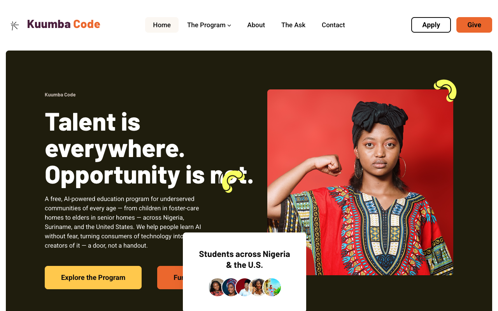

<div align="center">


# Kuumba Code

### Talent is everywhere. Opportunity is not.

A free, AI-powered education program for underserved communities of every age — from children in foster-care homes to elders in senior homes — across **Nigeria**, **Suriname**, and the **United States**.

We help people learn AI without fear, turning consumers of technology into creators of it — a door, not a handout.

[**kuumbacode.com**](https://www.kuumbacode.com/) · [Apply](https://www.kuumbacode.com/apply) · [Give](https://www.kuumbacode.com/pricing)



</div>

---

## The meaning behind the name

> *Kuumba* is Swahili for **creativity** — the sixth principle of the Nguzo Saba: to leave your community more beautiful and beneficial than you inherited it. *Code* means both the software you write and the code you live by. Together, our name stands for creativity, capability, and community.

---

## What this repository is

The source for the Kuumba Code website — a static HTML site with SCSS-compiled styles, deployed to Vercel.

| | |
|---|---|
| **Countries** | Nigeria · Suriname · United States |
| **Cost to students** | Free. Always. |
| **Funded by** | Grants, donations, sponsorships, community partnerships |
| **Fiscal sponsor** | Canticle Farm, a 501(c)(3) — EIN 46-1484633 |

---

## The Path — four courses, one transformation

One year. Four courses. Eight weeks each. Free, live, and virtual, taken in order. Every course ends with a real, published project — in public, with the student's name on it.

| | Course | What a student leaves with | Status |
|---|---|---|---|
| 01 | **Create** — Content & AI Strategy | A published voice | Running |
| 02 | **Grow** — Analytics, SEO & Growth | A growing following | Running |
| 03 | **Earn** — Lead Gen, Email & Monetization | A first income | Running |
| 04 | **Build** — Website, Brand & Platform | A platform they own outright | Coming soon |

**Two labs**, also free: the **AI Sales Video Bootcamp** (Nigeria intensive — four days on-site, thirty days of guided portfolio work) and the **BeatMaster Lab** (make real music with AI, then learn what to do with it).

---

## Getting started

```bash
npm install      # install dependencies
npm start        # compile SCSS + serve at localhost:3000 with live reload
npm run build    # one-off production CSS build (sass → autoprefixer)
```

`npm start` runs the SCSS watcher and [browser-sync](bs-config.js) in parallel. Styles are authored in `Template/assets/scss/` and compiled to `Template/assets/css/style.css` — **edit the SCSS, never the compiled CSS.**

### Layout

```
Template/              the site — every page, all assets (this is what deploys)
  assets/scss/         source styles → compiled to assets/css/style.css
  assets/images/       photography, logo, icons
Documentation/         theme documentation
bs-config.js           local dev server + clean-URL middleware
vercel.json            build config: outputs Template/, clean URLs on
CONTENT_TODO.md        outstanding placeholder copy, by page
```

### Deployment

Vercel builds with `npm run build` and serves `Template/` as the output directory. Clean URLs are on, so pages resolve without `.html` in production; locally the same behavior is provided by middleware in [bs-config.js](bs-config.js).

---

## Content status

The core pages — home, about, courses, bootcamp, apply, pricing — are **written and finished**. Remaining unfinished copy is tracked in [CONTENT_TODO.md](CONTENT_TODO.md): 129 `[PLACEHOLDER: …]` markers, concentrated in the blog and testimonial sections, most of them waiting on real student stories from the first cohort.

Two known gaps:

- `Template/assets/images/social/og-image.jpg` is referenced by the social meta tags but the folder is empty — link previews will render blank until it's added.
- The email capture forms use `action="#"` and are not wired to a backend. Donations and applications currently route through `mailto:` links and Google Forms.

---

## Get involved

Kuumba Code is free for every student we teach, and it stays free because of people who lend their time, voice, or resources.

- **Apply** — [kuumbacode.com/apply](https://www.kuumbacode.com/apply) · apply@kuumbacode.com
- **Volunteer or mentor** — tech support, translation, design, outreach, or a guest talk
- **Invite us** — schools, shelters, orphanages, faith communities, libraries, foster homes, prisons and community programs. We come to you, and we never charge the organisation or the learner.
- **Give or partner** — hello@kuumbacode.com · styner@kuumbacode.com

> Girls and women are the heart of our mission — and we teach boys and young men right alongside them. Every underserved learner who wants to grow is welcome.

---

## License & notices

This repository is **private and unlicensed for redistribution**. The site is built on a commercial theme; third-party components and their terms are recorded in [THIRD_PARTY_NOTICES.md](THIRD_PARTY_NOTICES.md) and [NOTICE.md](NOTICE.md). Photography is licensed stock and staff/student photos — review both files before making this repository public or reusing any asset elsewhere.

<div align="center">

**We hand people the keys. We don't rescue anyone.**

© 2026 Kuumba Code · Incubated at Canticle Farm, Oakland CA · Built by [StynerDev](https://www.stynerdev.com/)

</div>
